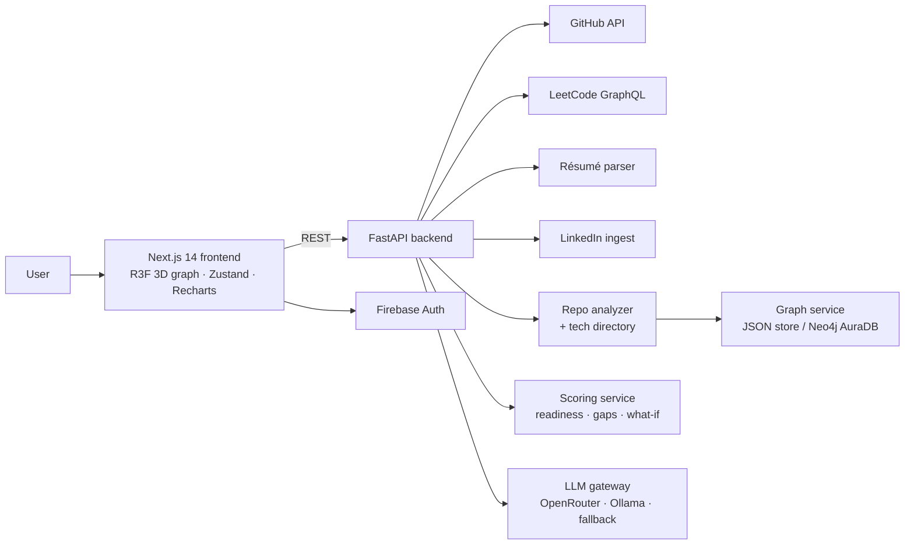

# PathForge

**Turn a developer's GitHub, LeetCode, résumé and LinkedIn into a verified skill graph, a 0–100 job-readiness score, and an AI career coach.**

**[▶ Live demo](https://pathforge-topaz.vercel.app)** · [Quick start](#-quick-start) · [Architecture](#-architecture) · [API](#-api-reference)


<!-- TODO: add a GIF or screenshot of the 3D graph here, e.g. docs/demo.gif -->

---

## 💡 The problem

Every résumé says "React, Python, Docker". Nothing proves it, and recruiters see the same claims from every applicant.

PathForge reads what a developer has **actually built** and turns that evidence into skills a recruiter can trust:

1. **Scan**: pull public repos, LeetCode stats, a résumé PDF and LinkedIn data.
2. **Verify**: detect languages, frameworks and concepts from code, READMEs and topics, and link every skill to the repos that prove it.
3. **Visualise**: render the result as an interactive 3D knowledge graph.
4. **Score**: compute a 0–100 readiness score for a target role (ML Engineer, Full Stack, DevOps…) with a prioritised skill-gap list.
5. **Coach**: chat with an AI copilot that knows your repos, and run "what if I learn X?" simulations.

---

## ✨ Highlights

| Feature | What it does |
|---|---|
| **3D knowledge graph** | Force-directed graph (Three.js, React Three Fiber, `d3-force-3d`) with brand icons, click-to-isolate subgraphs, market-demand glow and a 2D WebGL fallback |
| **Multi-signal repo analysis** | Combines GitHub language data, README/topic scanning against a curated tech directory, and concept extraction; skills seen in several repos are linked to all of them |
| **Multi-source ingestion** | GitHub OAuth, LeetCode GraphQL stats, AI résumé parsing (PDF or text), LinkedIn import, guided 4-step onboarding |
| **Readiness & gap analysis** | Role-specific 0–100 score with prioritised missing skills and a roadmap |
| **AI career copilot** | Chat grounded in your scanned repos, plus a What-If simulator ("PyTorch → +16% ML readiness") |
| **Recruiter mode** | Candidate scorecard, radar chart, analytics dashboard and PDF export |
| **Shareable profiles** | Public `/profile/[slug]` page with one-click LinkedIn sharing |
| **Zero-cost AI** | Open-weight models via OpenRouter (Gemma, Nemotron) or fully offline via Ollama (Qwen2.5), with a deterministic fallback when providers are rate-limited |

---

## 🏗 Architecture



| Layer | Stack |
|---|---|
| Frontend | Next.js 14 (App Router), React 18, TypeScript, Tailwind CSS, Framer Motion, Zustand, Recharts |
| 3D | Three.js, `@react-three/fiber`, `@react-three/drei`, `d3-force-3d` |
| Backend | FastAPI, Pydantic v2, Uvicorn |
| AI | Gemma / Nemotron via OpenRouter, Qwen2.5 via Ollama, heuristic fallback |
| Auth | Firebase (Google sign-in), GitHub OAuth, JWT |
| Data | JSON datastore, optional Neo4j AuraDB |
| Deploy | Docker Compose, Vercel |

<details>
<summary><b>Project structure</b></summary>

```
PathForge/
├── backend/
│   ├── main.py            # FastAPI entry point
│   ├── routes/            # auth, github, leetcode, resume, linkedin, graph,
│   │                      # career, chat, recruiter, profile, certifications
│   ├── services/          # repo_analyzer, tech_directory, scoring_service,
│   │                      # llm_service, graph_service, resume_service, …
│   └── schemas/           # Pydantic models
├── frontend/src/
│   ├── app/               # landing, login, setup, dashboard, analytics, profile/[slug]
│   ├── components/graph/  # KnowledgeGraph3D.tsx, GraphFilters.tsx
│   ├── components/panels/ # Copilot, Insight, Recruiter, Roadmap drawers
│   └── stores/            # Zustand stores
├── docker-compose.yml
└── .env.example
```
</details>

---

## 🚀 Quick start

**With Docker**

```bash
cp .env.example .env        # add OPENROUTER_API_KEY, or set AI_PROVIDER=ollama
docker compose up --build
```

Frontend at `http://localhost:3000`, API at `http://localhost:8000` (health check: `/health`).

<details>
<summary><b>Without Docker</b></summary>

```bash
# Backend
cd backend
python3 -m venv .venv && source .venv/bin/activate   # Windows: .venv\Scripts\activate
pip install -r requirements.txt
cp ../.env.example .env
uvicorn main:app --reload --port 8000

# Frontend (new terminal)
cd frontend
npm install
cp ../.env.example .env.local
npm run dev
```
</details>

<details>
<summary><b>Firebase, GitHub OAuth and AI provider setup</b></summary>

**Firebase Google sign-in**
1. Create a project in the [Firebase Console](https://console.firebase.google.com/) and enable Google as a sign-in provider.
2. Register a web app and copy its config into `frontend/.env.local` (`NEXT_PUBLIC_FIREBASE_API_KEY`, `_AUTH_DOMAIN`, `_PROJECT_ID`, `_STORAGE_BUCKET`, `_MESSAGING_SENDER_ID`, `_APP_ID`).
3. Generate a service-account key and save it as `backend/serviceAccountKey.json`.

**GitHub OAuth (optional)**
Create an OAuth app with callback `http://localhost:3000/auth/callback`, then set `GITHUB_CLIENT_ID` and `GITHUB_CLIENT_SECRET` in `backend/.env`.

**AI provider** (`AI_PROVIDER` in `backend/.env`)

| Mode | Setting | Notes |
|---|---|---|
| Hosted open-weight (default) | `openrouter` | Free models such as `google/gemma-4-26b-a4b-it:free` |
| Fully offline | `ollama` | `ollama run qwen2.5:7b-instruct` |
| Fallback | automatic | Heuristic engine keeps the app working if providers are down |
</details>

---

## 🔌 API reference

<details>
<summary><b>Endpoints</b></summary>

| Endpoint | Method | Description |
|---|---|---|
| `/auth/firebase` | POST | Authenticate a Firebase Google user |
| `/auth/github/login` · `/auth/github/callback` | GET | GitHub OAuth flow |
| `/user/me` | GET | Current user and connected accounts |
| `/user/onboarding` | POST | Complete target-role onboarding |
| `/profile/{username}` | GET | Public profile and verified skills |
| `/github/analyze-profile` | POST | Multi-repo scan and skill extraction |
| `/github/analyze` | POST | Single-repo analysis |
| `/leetcode/analyze` | POST | LeetCode stats and topic mapping |
| `/resume/upload` · `/resume/analyze-text` | POST | Résumé skill extraction |
| `/linkedin/ingest` | POST | LinkedIn profile import |
| `/graph/` | GET | Active knowledge graph |
| `/career/readiness` | GET | Readiness score and gaps |
| `/career/simulate` | POST | What-If simulator |
| `/chat/` | POST | AI career copilot |
| `/recruiter/summary` | GET | Recruiter scorecard |
</details>

---

## 🗺 Roadmap

- [ ] Demo GIF and screenshots in this README
- [ ] Deeper code-level (AST) skill evidence
- [ ] Downloadable "Verified Skill Report" for recruiters

---

## 👤 Author

**Rohith Pullola**, B.Tech AI & ML, CMR College of Engineering and Technology, Hyderabad (2027)

[Portfolio](https://rohithpullola.me) · [GitHub](https://github.com/Rohithsilent)

Open to AI / software engineering internships.

## 📄 License

[MIT](LICENSE)
